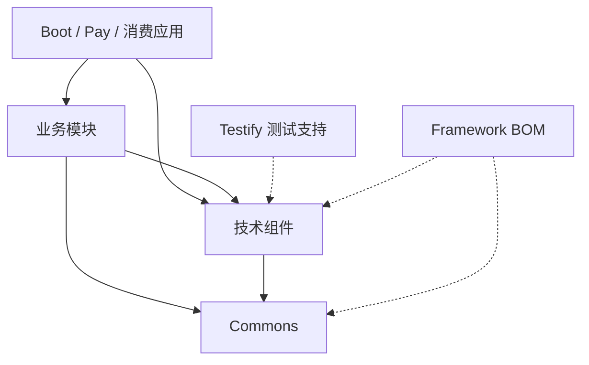

# LoadUp Framework 架构

## 职责与发布

Framework 发布由 `loadup-framework-bom` 对齐的基础库和技术组件。根 Maven reactor 聚合 BOM、Commons 和 Components，
`loadup-coverage` 由 `component-coverage` profile 额外装配。业务模块和 Testify 分别在独立仓库维护，Boot 和 Pay 等应用负责运行时组合。

实线表示运行时可依赖方向，虚线表示测试关系或版本管理。

## 组件划分与装配

Commons 提供执行上下文、DTO、错误码、JSON、日志、脱敏和工具。Runtime 负责将共享 Clock 等能力装配到 Spring Boot。Components
按数据、安全、Web、集成、可靠性、执行和平台划分。可替换后端的技术组件通过 API 和 binder 发布，业务模块按需引入公开契约与 Web
适配工件。

业务 Facade 使用客户端契约，HTTP 报文由 Web 适配层处理。小型业务模块以 client、core、web 发布，core 内保留
app、domain、infrastructure 边界。UPMS 等需要独立装配的模块分别发布更多层。

## 数据库与部署边界

每个部署使用一个固定的 PostgreSQL schema。宿主通过 `loadup.database.schema` 对齐连接池和 Flyway，启动时校验物理连接的当前
schema 与完整搜索路径。关系表以部署为边界，业务 API 和持久化查询使用各自的业务键。应用内部调用身份由 `DeploymentIdentity`
表达。

基础单表读写可使用 Spring Data JDBC，复杂筛选、行锁和批量更新使用参数化 Spring JDBC。业务 SQL 负责删除。两条访问路径共享 Spring
事务连接。宿主确保非关系存储的命名空间与部署边界一致。

[框架接入](README.md) · [组件设计](loadup-components/ARCHITECTURE.md) · [数据库架构](loadup-components/data/loadup-components-database/ARCHITECTURE.md)
