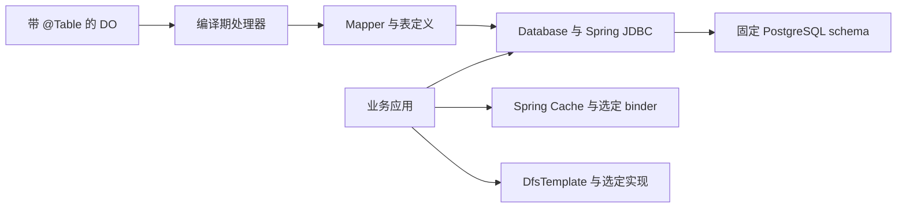

# 数据与存储组件架构

## 职责与依赖

数据库与 DFS 各自拥有持久化边界。应用在数据库中维护业务记录，在 DFS 中维护文件内容和存储元数据，并对跨存储写入安排补偿。Mapper 和表定义由编译期处理器生成，运行期由 Database 装配使用。

宿主直接依赖所需的组件工件。目录对应 Maven reactor 的聚合层，运行时依赖由各组件 POM 声明。

## 组件设计

- [KV 与缓存](loadup-components-kv/ARCHITECTURE.md)
- [数据库](loadup-components-database/ARCHITECTURE.md)
- [文件存储](loadup-components-dfs/ARCHITECTURE.md)

[接入说明](README.md)
