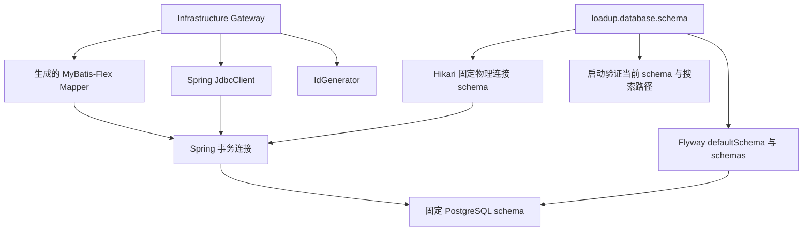

# Database 组件架构

## 持久化边界

组件为 MyBatis-Flex 和 Spring JDBC 提供持久化约定、共享事务、固定 schema、Flyway 装配以及 ID 和序列能力。宿主选择数据源、驱动和部署迁移。简单查询由生成 Mapper、`ServiceImpl` 和 `QueryWrapper` 处理，复杂筛选、加锁、条件更新与批处理使用参数化 JDBC。

`BaseDO` 维护公共字段。MyBatis-Flex 保留应用指定的 ID。审计时间使用共享业务 Clock 及其时区。

| 字段 | 列 | 类型 | 行为 |
| --- | --- | --- | --- |
| `id` | `id` | `VARCHAR(64)` | 显式赋值，Flex 主键策略为 `KeyType.None` |
| `createdAt` | `created_at` | `TIMESTAMP(6)` | 插入时写入 |
| `updatedAt` | `updated_at` | `TIMESTAMP(6)` | 插入与更新时写入 |
| `deleted` | `deleted` | `BOOLEAN` | false 为有效，true 为已删除 |

`MyBatisFlexCustomizer` 统一逻辑删除、分页缺省值和 banner 设置。带 `deleted` 列的 Mapper 按全局约定读写，显式 SQL 自行设置审计字段及筛选删除标记。

## 编译生成与事务

[注解处理器](../loadup-components-database-processor/ARCHITECTURE.md) 维护唯一的生成策略。每个 `@Table` 实体会得到上一级包下的 `mapper.XxxMapper` 与 `table.XxxTableDef`，表定义汇总于 `Tables`。Mapper 带 `@Mapper` 并继承 `BaseMapper<XxxDO>`。处理器输出与运行时配置各由对应工件维护。

自动配置扫描 `io.github.loadup` 下的 `BaseMapper` 子类型。存在单个数据源且 Gateway 注入时，懒加载的 Mapper 初始化。会话工厂优先复用其 DataSource 或 Flex 包装的单一 DataSource 上的 Spring 连接，其他情形使用 Flex 的默认事务行为。MyBatis 本地缓存为 `STATEMENT`，避免同一事务中 JDBC 更新后读取到会话缓存的旧数据。

## 固定 schema 与迁移归属

`FixedSchemaEnvironmentPostProcessor` 对齐连接池的 schema，拒绝不一致的显式 schema 和可改变连接初始状态的配置。`FixedSchemaVerifier` 在 Worker 等后台执行器开始前验证 `current_schema()` 与完整 `search_path`。请求和后台任务共用固定数据源，部署身份与连接目标分别配置。

数据库角色负责实际访问边界。迁移与运行账号按部署分权，跨 schema 权限需在目标数据库验收。非关系存储按部署配置自己的命名空间。

`LoadUpFlywayAutoConfiguration` 将相同 schema 应用于 `defaultSchema` 和 `schemas`。应用选择明确的迁移位置，每个应用的所选脚本共享一个历史记录。脚本使用当前 schema 下的未限定表名，已发布版本保留原内容。

## 序列分配

`BusinessIdGenerator` 在 Sequence 可用时提供默认应用 ID。Sequence 通过 Spring JDBC 以独立的 `REQUIRES_NEW` 事务预留区间，按 schema 内唯一 `scope_key` 更新分配上界，业务回滚后号码仍然有效。

每个作用域持有一个活跃区间和最多一个备用区间，剩余 20% 时开始预取。热路径用原子操作领取号段中的号码，并发冷启动共享一次分配。初始化和死锁等短暂故障在新事务中有限重试并加入抖动。预取失败保留当前区间，失败冷却抑制重复分配请求。队列拒绝、超时、容量耗尽、最大值不一致和作用域接纳失败通过带 `DatabaseResultCodeEnum` 的 `CommonException` 报告。

作用域达到上限时可清理过往日期的缓存。未用号段丢弃，已在运行的分配可能提交但对新的缓存条目不可见。常驻与当前日期作用域保留，超出的请求返回错误。关闭应用会停止预取并结束未完成的等待。

[接入、配置与业务 ID 格式](README.md)
