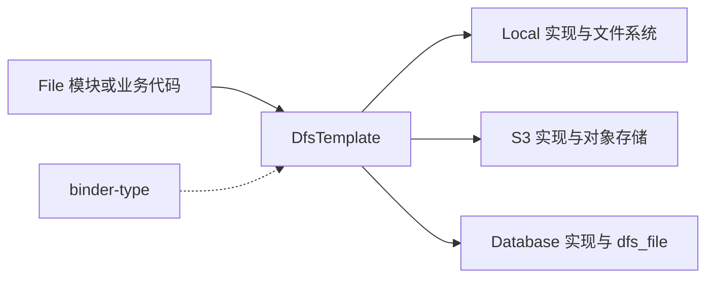

# DFS 架构

## 运行时装配



每个 binder 直接实现并注册 `DfsTemplate`，通过 `loadup.dfs.binder-type` 控制生效。配置在共享的 `DfsAutoConfiguration` 之前加载，File 等可选消费者在共享装配点之后检查 Bean。

S3 binder 管理 AWS SDK 的 `S3Client` 和 `S3Presigner`，通过对象元数据记录文件名和用户数据，提供预签名 GET 与分片操作。通过 endpoint 和 path-style 参数可连接兼容服务。Local binder 将文件和旁车元数据分别写在根目录下。Database binder 使用 Spring JDBC 在 `dfs_file` 保存内容、JSON 元数据和审计字段，适合过渡期小文件。

公开契约使用组件自身的请求、响应和能力接口。binder 持有底层客户端，下载响应负责关闭数据流，由调用方在读取结束后关闭。

## 分层与调用路径

预签名与分片操作取决于所选 binder 的能力。

```text
loadup-components-dfs
  └─ loadup-components-dfs-api
  └─ loadup-components-dfs-binder-database
  └─ loadup-components-dfs-binder-local
  └─ loadup-components-dfs-binder-s3
```

聚合 POM 组织模块与版本，运行时依赖由子模块决定。
各 binder 在自己的 `src/test` 中验证存储行为；本地 binder 也覆盖 DFS 服务契约。
数据库和 S3 集成测试分别通过 Testcontainers 启动 PostgreSQL 和 LocalStack。

## 设计取舍

聚合层只表达模块组合和依赖方向，实际能力由选定的子模块提供。

集成方式与配置示例见 [README.md](README.md)。
