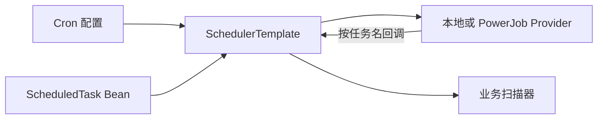

# Scheduler 架构

## 注册与触发

Scheduler API 绑定并校验全部任务定义，`SchedulerTemplate` 管理任务分派和生命周期。自动触发限定在配置的任务名中，手动触发可使用任意已注册的任务。同一
JVM 的同名任务重叠时跳过本次触发，处理失败后释放执行标记。业务异常由 binder 接收。

Local binder 注册并取消 Spring Cron 触发器。PowerJob binder 通过原生 Client 同步持久化任务，通过 Worker
回调统一分派入口。工作流、分片和实例管理继续使用 PowerJob 原生 SDK。

新增阿里云、AWS 等平台时，独立模块按 `loadup.scheduler.binder-type` 装配一个 `SchedulerProvider`，并声明
`@AutoConfiguration(before = SchedulerAutoConfiguration.class)`。Provider 接收标准任务定义和按名称分派的回调，负责转换
Cron、校验平台支持的频率和管理平台任务生命周期。接收平台触发的方式与身份校验由 binder 实现。
