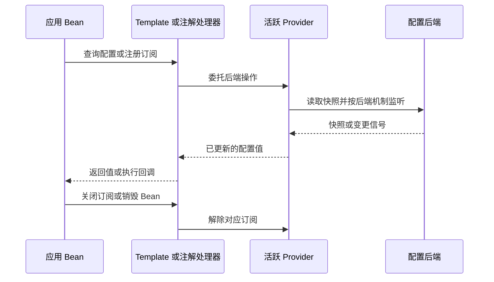

# ConfigCenter 架构

ConfigCenter 采用单后端模式。API 定义 `ConfigCenterTemplate`、`ConfigCenterProvider` 和 `@DynamicConfig`。各 binder 按 `loadup.configcenter.binder-type` 装配 Provider，并持有底层 SDK 或 OpenAPI 客户端的生命周期。API 自动配置在存在唯一 Provider 时装配默认 Template 和注解处理器。

Template 委托 Provider 处理查询和发布。注解处理器和 Template 通过同一个 Provider 注册独立订阅，Provider 返回单个订阅的解除操作。Template 保存程序化订阅，Spring bean 的销毁回调清理注解订阅。

## 查询与变更分派

XXL-Conf 用官方 OpenAPI 做查键、查值和长轮询。收到变更信号后批量重查当前订阅键，等待超时和重连期间也会重新对比。Nacos 将一个 `dataId + group` 文档转换为键值快照，用 SDK 订阅刷新。Apollo 用 SDK 订阅已发布配置，可选的 Portal OpenAPI 负责编辑和发布。
