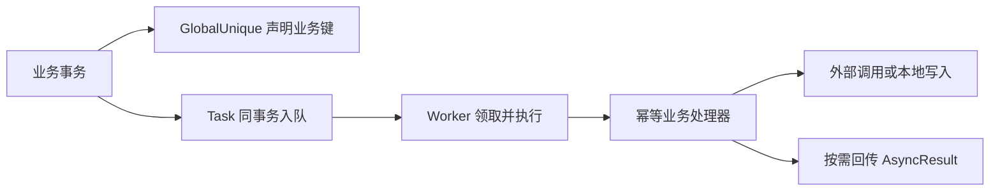

# 应用可靠性组件架构

## 职责与依赖

幂等声明依靠数据库唯一约束，互斥依靠锁后端，异步结果通过关联键传递。Task 在业务事务中持久化任务，Worker 在提交后领取。调用是否可重试以及外部副作用如何去重由业务处理器决定。

宿主直接依赖所需的组件工件。目录对应 Maven reactor 的聚合层，运行时依赖由各组件 POM 声明。

## 组件设计

- [持久化任务](loadup-components-task/ARCHITECTURE.md)
- [异步结果](loadup-components-async-result/ARCHITECTURE.md)
- [分布式锁](loadup-components-lock/ARCHITECTURE.md)
- [幂等声明](loadup-components-globalunique/ARCHITECTURE.md)
- [调用容错](loadup-components-resilience4j/ARCHITECTURE.md)

[接入说明](README.md)
