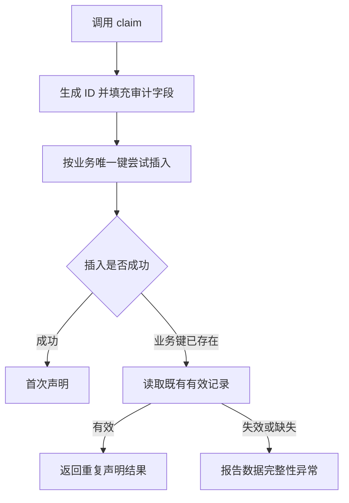

# Global Unique 架构

## 业务键与存储

`GlobalUniqueTemplate` 提供同一部署内的幂等声明。组件维护 PostgreSQL `global_unique` 表，以 `UNIQUE (biz_type, unique_key)` 作为最终裁决。Database 组件提供 ID 生成及固定 schema，记录按部署隔离。

业务类型和唯一键先去除首尾空白，再校验非空和长度上限，分别为 64 和 255 个字符。`bizId` 和 `requestData` 用于诊断，唯一性由业务类型和唯一键决定。插入使用 PostgreSQL `ON CONFLICT (biz_type, unique_key) DO NOTHING`，其他约束错误继续向上传递。

## 事务边界

组件通过 Spring JDBC 使用 Spring 管理的连接。调用方需将声明与业务写入放入同一事务，才能随业务失败一起撤销。独立调用的声明会单独提交。仓储读取显式过滤 Boolean 逻辑删除标记。

[依赖和表迁移](README.md) · [数据库 schema 与事务](../../data/loadup-components-database/ARCHITECTURE.md)
