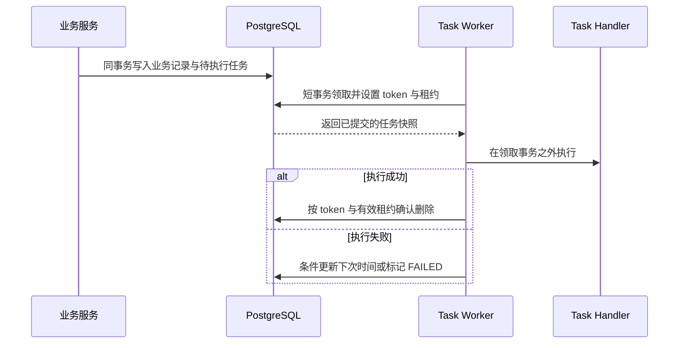

# Task 架构

单一 jar、单一 TaskTemplate/TaskHandler 接口、单一任务主表。消息载荷与执行时间是任务属性，不设旧组件模式或双状态机。

## 提交、执行与确认

业务事务：业务写入 + submit，同步提交或回滚。
领取事务：仅在本实例可处理的类型中恢复已耗尽尝试次数的过期租约，再用 SKIP LOCKED 领取一条记录，生成新 token、递增 attempts、设置租约，提交。
事务外：调用 Handler。
确认事务：按 id、RUNNING、token 和有效租约条件删除或延后。

TaskDispatcher 挂起调用方事务；领取、确认与人工操作使用独立短事务。数据库时间决定就绪、租约与重试，避免节点时钟差。逐条领取执行，不预领整批。任务行只保留下次执行时间与提交时的尝试上限。领取和失败时读取类型配置，分别计算租约截止时间和重试时间。业务截止时间仍由业务表维护。

PENDING → RUNNING → 成功确认后删除；异常返回 PENDING 或耗尽进入 FAILED。过期 RUNNING 可重领或进入 FAILED。取消清空 token；改期和人工重试清零 attempts。旧执行者不能回写新状态，但可能仍产生外部副作用，业务幂等依然必要。

数据库对 `(task_type, biz_id)` 建立唯一约束。同一业务下的独立投递或下一代任务使用不同 bizId。任务 payload、type 和业务 ID 在登记后保持不变。重复提交不会重置队列时间，主动改期通过 reschedule。去重只覆盖仍在队列表中的记录。成功删除后，由业务结果或唯一约束提供长效幂等。

完成后查询从业务状态读取结果。应用可以从已提交的业务结果推导完成，任务尝试次数随队列行一起删除。

本地 TaskWorker 是默认触发入口，按固定延迟扫描。选择 Scheduler 后，本地 Worker 停止，由已有 binder 按 Cron 唤醒同一个 Dispatcher。两个入口默认每分钟扫描，每批最多 10 条，逐条领取并串行处理。Dispatcher 根据本地 Handler 生成类型白名单，task-type 只能缩小范围；白名单为空不扫描。慢任务和关键投递可分别部署执行节点。

Scheduler 只负责触发；提交、领取和确认的接口不依赖 Scheduler binder、PowerJob、ORM 或消息中间件。同一 JDBC 实现根据配置加载 PostgreSQL 或 MySQL 语句。表前缀通过白名单校验，其余数据均通过 JDBC 参数绑定。测试源码与静态审阅不代表实际数据库故障恢复验收。
