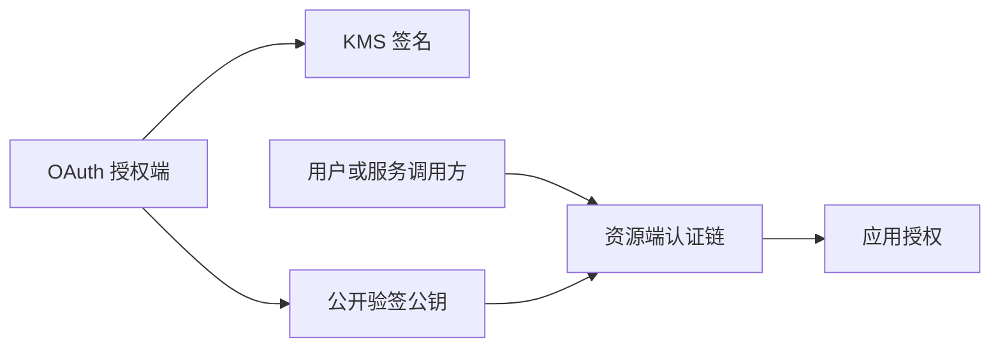

# 安全与身份组件架构

## 职责与依赖

OAuth Server 用 KMS 管理签名密钥，资源端按 issuer、受众、用途和时效校验 JWT。应用认证链向方法授权提供可信身份。服务身份和报文签名各有独立的协议边界，验证码由对应的应用入口使用。

宿主直接依赖所需的组件工件。目录对应 Maven reactor 的聚合层，运行时依赖由各组件 POM 声明。

## 组件设计

- [OAuth2 与 JWT](loadup-components-oauth-server/ARCHITECTURE.md)
- [方法授权](loadup-components-authorization/ARCHITECTURE.md)
- [服务身份](loadup-components-service-auth/ARCHITECTURE.md)
- [密钥与机密管理](loadup-components-kms/ARCHITECTURE.md)
- [报文签名](loadup-components-signature/ARCHITECTURE.md)
- [验证码](loadup-components-captcha/ARCHITECTURE.md)

[接入说明](README.md)
